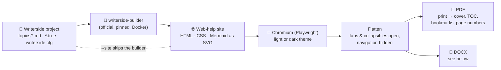
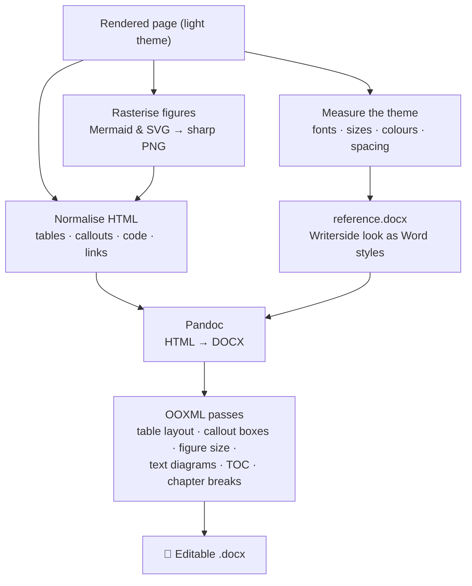
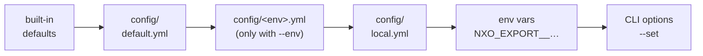
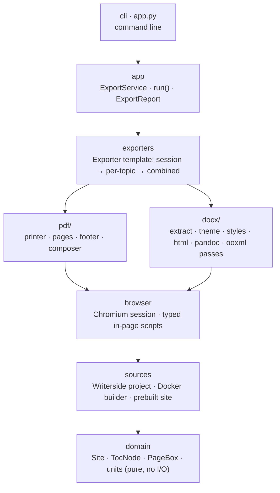

# nxo-export

**Turn a JetBrains Writerside project into print-ready PDF and editable Word documents that look like the
published Writerside site.**

- 📄 **PDF:** light or dark, printed from the real Writerside site with its own styles, Mermaid diagrams
  included.
- 📝 **DOCX:** something Writerside cannot do. A real Word document that business analysts can edit, built on
  named Word styles derived from the Writerside theme.
- 📚 **One combined document** with cover, table of contents and bookmarks, **and/or one file per topic**.

```bash
python app.py -p ~/docs/Writerside -i docs -f pdf -f docx -m both
```

---

## Contents

- [Why this exists](#why-this-exists)
- [Quick start](#quick-start)
- [Usage](#usage)
- [How it works](#how-it-works)
- [Configuration](#configuration)
- [Output](#output)
- [The Word document](#the-word-document)
- [Troubleshooting](#troubleshooting)
- [Limitations](#limitations)
- [Development](#development)

---

## Why this exists

| | Writerside PDF export | Browser *Print → PDF* | **nxo-export** |
|---|:---:|:---:|:---:|
| Keeps the Writerside web styles | ❌ | ✅ | ✅ |
| Dark mode | ❌ | ✅ (one page at a time) | ✅ |
| Whole instance, TOC with page numbers, bookmarks | ✅ | ❌ | ✅ |
| Tabs and collapsibles printed open | – | ❌ | ✅ |
| Wide tables fit the page (no scrollbar cut-off) | – | ❌ | ✅ |
| **Editable DOCX** | ❌ | ❌ | ✅ |
| Scriptable (CI, Docker) | ✅ | ❌ | ✅ |

The tool does **not** re-implement Writerside. The official Writerside builder renders the site, so includes,
`%variables%`, filters, snippets and Mermaid are resolved exactly as published. The exporter then prints that
site (PDF) or translates it into Word structures (DOCX).

---

## Quick start

**You need:** Python ≥ 3.11, Docker (runs the Writerside builder), and Pandoc ≥ 3 (DOCX only:
`brew install pandoc`).

```bash
# 1. Install (once)
cd nxo-export                         # this repository
python3 -m venv .venv
source .venv/bin/activate            # Windows: .venv\Scripts\activate
pip install -e '.[dev]'
playwright install chromium
python app.py doctor                 # checks Docker, the builder image, Chromium and Pandoc

# 2. Find your instance (tree) id
python app.py instances -p /path/to/Writerside

# 3. Export
python app.py -p /path/to/Writerside -i docs -f pdf -f docx -m both
```

The files are in `dist/docs/`.

> [!NOTE]
> The first run pulls the builder image (~1.7 GB) and builds the site, which takes a few minutes. On Apple
> Silicon the amd64 image runs emulated, so it is slower. Later runs reuse the build until your sources
> change. Your Writerside folder is never modified, because the builder works on a copy.

> [!TIP]
> Open a new terminal? Run `source .venv/bin/activate` first. If you forget, `app.py` tells you.

---

## Usage

### Exporting

You do **not** pass a `.tree` file. Pass the Writerside folder (the one with `writerside.cfg`) and the
**instance id**, which is the id of the tree. `export` is the default command, so you can leave it out.

```bash
python app.py -p /path/to/Writerside -i docs                          # combined light PDF (defaults)
python app.py -p /path/to/Writerside -i docs -f pdf -t dark           # combined dark PDF
python app.py -p /path/to/Writerside -i docs -f docx                  # combined DOCX
python app.py -p /path/to/Writerside -i docs -f pdf -f docx -m both   # everything, combined + per topic
python app.py -p /path/to/Writerside -i docs -f docx -m per-topic --topic 'database-*'   # some topics only
```

| Option | Values | Default |
|--------|--------|---------|
| `-p, --project` | Writerside folder (with `writerside.cfg`) | `project.path` |
| `-i, --instance` | instance (tree) id | `project.instance` |
| `-f, --format` | `pdf`, `docx` (repeatable) | `pdf` |
| `-m, --mode` | `combined`, `per-topic`, `both` | `combined` |
| `-t, --theme` | `light`, `dark` (PDF only; DOCX is always light) | `light` |
| `--topic` | topic id, file slug or glob (repeatable) | all topics |
| `-o, --out` | output folder | `dist/` |
| `--site` | an already built site (folder or `webHelp*-all.zip`), which skips the builder | – |
| `--offline` | never download Writerside CDN assets (needs a warm cache) | off |
| `--strict` | fail on Writerside inspection errors | off |
| `--set KEY=VALUE` | any config key, e.g. `--set render.page.size=Letter` (before the options) | – |

### Other commands

| Command | What it does |
|---------|--------------|
| `python app.py instances -p DIR` | List the instances (trees) of a project |
| `python app.py build -p DIR -i ID` | Only run the Writerside builder; print the site folder |
| `python app.py config show` | Print the effective configuration |
| `python app.py config validate` | Check the configuration and the project without exporting |
| `python app.py doctor` | Check Docker, the builder image, Chromium and Pandoc |

`nxo-export …` and `python -m nxo_export …` are the same as `python app.py …` when the venv is active.

### From Python

```python
from nxo_export import run

report = run("/path/to/Writerside", "docs", formats=["pdf", "docx"], mode="both", theme="dark")
print(report.outputs)    # list[Path]
print(report.warnings)   # list[str]
```

`run()` accepts the same options as the command line (`out`, `topics`, `site`, `offline`, `strict`, `env`),
plus `settings={"render.page.size": "Letter"}` for any other key. Anything you leave out comes from the config
files.

### Without Docker: `--site`

If you already have the web-help output, from the Writerside IDE (*Export → Web Help*) or from
`JetBrains/writerside-github-action` in CI, skip the builder:

```bash
python app.py --site webHelpDOCS2-all.zip -f pdf -f docx -m both
```

### Fully in Docker

```bash
WRITERSIDE_PROJECT=/path/to/Writerside docker compose run --rm export -i docs -f pdf -t dark
```

The image contains the CLI, Chromium and Pandoc. The builder runs as a *sibling* container through the
mounted Docker socket, and both share the named volume `nxo-export-work`.

> [!WARNING]
> Mounting the Docker socket gives the container root-equivalent access to the Docker daemon. If that is not
> acceptable, build the site separately and use `--site`.

---

## How it works



Builds are cached by a fingerprint of the sources, the builder image and the instance
(`builder.reuse_cache`).

### The DOCX pipeline

Word has no CSS, so the DOCX is not a screenshot of the page. The rendered page is translated into native Word
structures, and the Writerside look is expressed as **named Word styles**:



> [!NOTE]
> **Why not convert the Markdown directly?** Only the Writerside builder resolves includes, `%variables%`,
> filters, snippets, XML topics and Mermaid. Converting the `.md` files would silently lose or garble that
> content.

---

## Configuration

Two files cover everyday use:

| File | In git | Purpose |
|------|:---:|---------|
| `config/default.yml` | ✅ | shared settings; every key is commented |
| `config/local.yml` | ❌ ignored | your settings (start from `config/local.example.yml`) |

```bash
cp config/local.example.yml config/local.yml   # set project.path and project.instance
python app.py export                           # now no flags are needed
```

Settings are layered, and each layer overrides the one before:



- **Environment variables:** `NXO_EXPORT__SECTION__KEY=value`, e.g. `NXO_EXPORT__RENDER__THEME=dark`.
- **In YAML:** values may use `${VAR}` or `${VAR:-default}`. Unknown keys are rejected, so typos fail loudly.
- **Per-environment files are optional.** When CI or a release needs different settings, add
  `config/ci.yml` and run with `--env ci` (or `NXO_EXPORT_ENV=ci`).

### Most useful keys

| Key | Default | Meaning |
|-----|---------|---------|
| `project.path` / `project.instance` | – | Writerside folder and tree id |
| `output.formats` / `output.mode` / `output.dir` | `[pdf]` / `combined` / `./dist` | what to produce and where |
| `render.theme` | `light` | `light` or `dark` (PDF only) |
| `render.page.size`, `render.page.margin_*` | `A4`, 16/18/16 mm | page geometry, e.g. `Letter`, `A4 landscape` |
| `render.toc.enabled` / `render.toc.depth` / `render.toc.title` | `true` / `3` / `Contents` | table of contents |
| `render.cover.enabled` / `render.cover.subtitle` | `true` / – | cover page |
| `render.table_min_scale` | `0.75` | how far wide tables may shrink before text wraps |
| `render.link_base_url` | – | published site URL, which keeps cross-topic links clickable |
| `docx.reference_doc` | – | your own Word template instead of the derived styles |
| `docx.font` / `docx.code_font` | theme fonts | force fonts, e.g. `Arial` / `Consolas` |
| `docx.image_scale` | `2` | pixel density of diagrams in Word |
| `builder.image` | pinned | Writerside builder version (run the e2e test when bumping it) |

Run `python app.py config show` to see every key with its effective value.

---

## Output

```
dist/<instance>/
├── <instance>-light.pdf          combined PDF (or -dark)
├── pdf-light/NNN-<slug>.pdf      one PDF per topic, in TOC order
├── <instance>.docx               combined DOCX
└── docx/NNN-<slug>.docx          one DOCX per topic
```

---

## The Word document

Everything in the DOCX uses a named style. If you change a style in Word, every occurrence changes with it,
and the document stays consistent as analysts edit it.

| Writerside element | Word style | Notes |
|--------------------|------------|-------|
| Headings | `Heading 1`–`6` | Writerside sizes and vertical rhythm |
| Paragraphs | `Body Text`, `First Paragraph`, `Compact` | |
| Tables | `Table` (table style) | grey grid, shaded header repeated on every page, measured column widths, wide tables scaled to fit |
| Code blocks | `Source Code` | coloured with the site's own Prism highlighting |
| ASCII / box-drawing diagrams | `Text Diagram` | a code block **without a language** using `┌ ─ │ └ …`: monospace, exact spacing, kept on one page. Give the block a language to keep it as code |
| Callouts | `Callout Note` / `Tip` / `Warning` | shaded boxes like the site |
| Tabs | `Tab Title` | every tab printed in turn, each under its title |
| Mermaid / SVG / images | `Figure`, `Figure Bordered` | sharp light-theme PNGs, never larger than the page |
| Links | `Hyperlink` | in-document links work; cross-topic links need `render.link_base_url` |
| Emoji | `Emoji` | uses `docx.emoji_font` |

The combined document also has a cover (`Title`, `Subtitle`, `Date`), a pre-filled clickable TOC, chapter
breaks and "Page X of Y" footers. The DOCX is always light: Word has no dark mode.

---

## Troubleshooting

| Symptom | Fix |
|---------|-----|
| `nxo_export is not installed in this Python` | `source .venv/bin/activate` |
| `pandoc not found on PATH` | `brew install pandoc` (DOCX only) |
| Docker / builder errors | start Docker Desktop, then run `python app.py doctor` |
| `project defines several instances` / `instance … not found` | `python app.py instances -p DIR`, then pass `-i <id>` |
| `no topic matches …` | `--topic` matches the topic id, the file slug (`my-topic`) or a glob (`'db-*'`) |
| First run is very slow | expected: image pull and an emulated build on Apple Silicon. Later runs are cached |
| `--offline` fails | the CDN cache is cold; run once without `--offline` |
| Word asks to *update fields* | click Yes; it only refreshes the TOC page numbers |
| Fonts look different in Word | install *JetBrains Sans/Mono*, or set `docx.font` / `docx.code_font` |
| Run fails on content warnings | you are in `--strict` mode; fix the Writerside inspection errors or drop `--strict` |

---

## Limitations

- **Builder pin.** The in-browser scripts (`src/browser/assets/`) target the DOM of the pinned
  `writerside-builder` version. When you bump `builder.image`, run the e2e test.
- **CDN assets.** The site loads CSS, JS and fonts from `resources.jetbrains.com`. They are cached under
  `render.asset_cache_dir`; use `--offline` for hermetic runs.
- **Word is not a browser.** The DOCX reproduces the look with styles; it is not a pixel copy.
- **Emoji.** LibreOffice's PDF export does not draw colour emoji. Word for Mac falls back to Apple Color Emoji.
- **Cross-topic links** are clickable only when `render.link_base_url` is set. In-page anchors always work.

---

## Development

```bash
source .venv/bin/activate
pytest -q                                                              # unit tests (seconds)
WS_E2E_PROJECT=/path/to/Writerside WS_E2E_INSTANCE=docs pytest -m e2e   # real builder + browser + pandoc
ruff check src tests
```

### Architecture

Layers depend inwards only, and `tests/test_architecture.py` enforces it:



```
src/                       installed as the `nxo_export` package
├── domain/                pure values: Site/TocNode, ExportJob, PageBox, units, CSS parsing
├── sources/               Writerside project, Docker builder, prebuilt dir/zip
├── browser/               Chromium session + typed wrappers for browser/assets/*.js
├── exporters/
│   ├── pdf/               printer, cover/TOC pages, footer stamp, composer
│   └── docx/              extract → theme → styles → html → pandoc → ooxml/passes
└── app/                   ExportService, run(), ExportReport
```

### Extending

| I want to… | Do this |
|------------|---------|
| add an output format | implement `exporters.base.Exporter`, register it in `exporters/registry.py` |
| change the Word look | edit `exporters/docx/styles/catalogue.py` (the one place styles are declared) |
| add a DOCX fix-up | write a `DocumentPass`, add it to `exporters/docx/ooxml/pipeline.py` |
| add a subpackage | also list it under `[tool.setuptools] packages` in `pyproject.toml` (a test checks this) |

Design and rationale: [`.github/plans/oop-refactor/design.md`](.github/plans/oop-refactor/design.md) and
[`.github/plans/bootstrap/plan.md`](.github/plans/bootstrap/plan.md).
