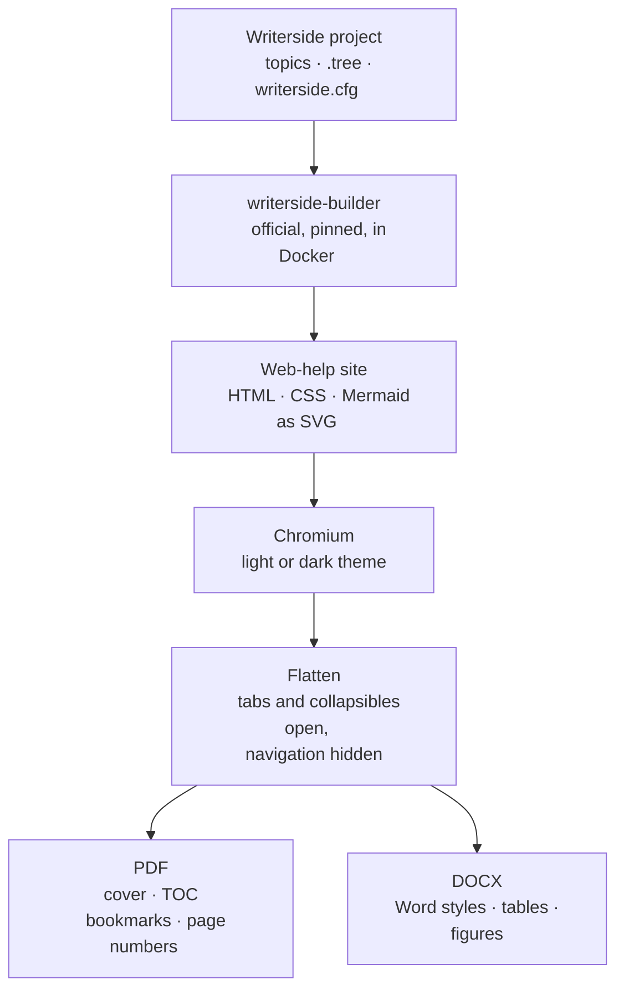
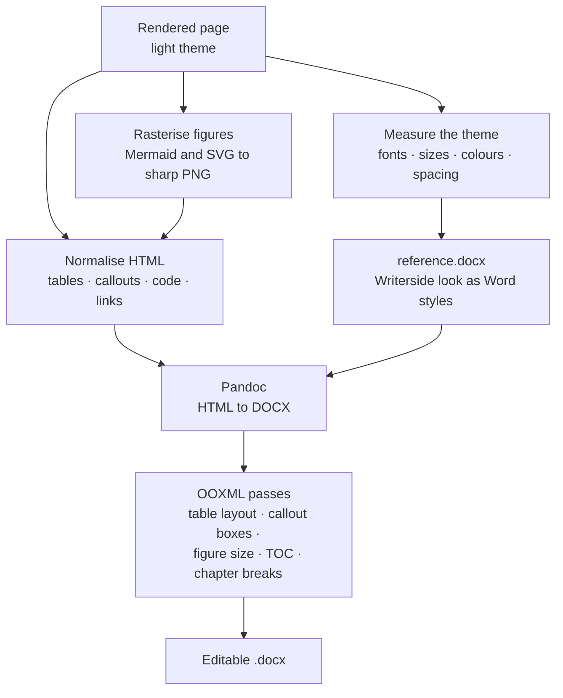
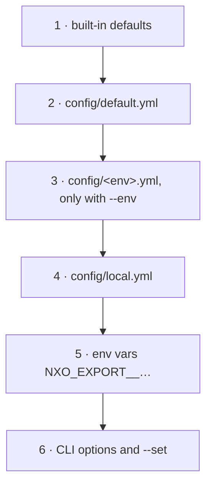
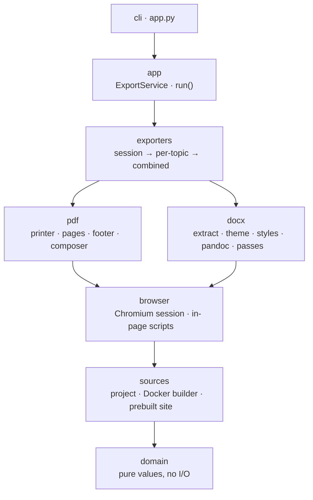

# nxo-export: Writerside to PDF and editable Word

<show-structure for="chapter" depth="2"/>

<web-summary>
nxo-export turns a JetBrains Writerside project into print-ready PDF (light or dark) and editable Word
documents that keep the look of the published Writerside site.
</web-summary>

<card-summary>
Print-ready PDF and editable DOCX from any Writerside instance, styled like the published site.
</card-summary>

<link-summary>
How nxo-export turns a Writerside instance into PDF and editable Word documents.
</link-summary>

Writerside produces beautiful web help. Getting the same content *out* of the browser is harder. The built-in
PDF export drops the web styles. Printing from the browser works one page at a time and cuts off wide tables.
There is no way at all to get an **editable Word document**, which is the format business analysts,
reviewers and auditors actually work in.

**nxo-export** closes that gap. Point it at a Writerside folder and an instance id, and it produces:

<deflist type="medium">
<def title="📄 PDF, light or dark">
The real Writerside site, printed by Chromium with its own styles. The PDF has a cover, a table of contents
with page numbers, bookmarks and page footers. Tabs and collapsible sections are printed open, and wide tables
are scaled to fit the page.
</def>
<def title="📝 Editable DOCX">
A native Word document built on named Word styles that are measured from the Writerside theme. It has real
headings, real tables, sharp diagrams and a clickable table of contents, ready for analysts to edit.
</def>
<def title="📚 Combined or per topic">
One document for the whole instance, one file per topic, or both in a single run.
</def>
</deflist>

```bash
python app.py -p ~/docs/Writerside -i docs -f pdf -f docx -m both
```

## Why another exporter?

Writerside users already have two ways to get a PDF. Neither covers the whole job:

| | Writerside PDF export | Browser *Print → PDF* | **nxo-export** |
|---|:---:|:---:|:---:|
| Keeps the Writerside web styles | ❌ | ✅ | ✅ |
| Dark mode | ❌ | ✅ one page at a time | ✅ |
| Whole instance, TOC with page numbers, bookmarks | ✅ | ❌ | ✅ |
| Tabs and collapsibles printed open | – | ❌ | ✅ |
| Wide tables fit the page | – | ❌ | ✅ |
| **Editable DOCX** | ❌ | ❌ | ✅ |
| Scriptable in CI and Docker | ✅ | ❌ | ✅ |

The editable DOCX is the part nobody else offers. Documentation written by engineers in Writerside often has
to be reviewed, annotated and extended by people who live in Microsoft Word. Until now that meant
copy-and-paste and a document that drifted from its source on day one.

<tip>
The design rule behind every decision: <b>do not re-implement Writerside</b>. The official Writerside builder
renders the site, so includes, variables, filters, snippets, XML topics and Mermaid are resolved exactly as
they are when you publish. nxo-export only takes over after that.
</tip>

## How it works

The pipeline has one shared front half and two back ends:



1. **Build.** The official `writerside-builder` image renders the instance into a web-help site. The build is
   cached by a fingerprint of the sources, the builder image and the instance, so later runs are instant until
   something changes. Your Writerside folder is never modified, because the builder works on a copy.
2. **Render.** Each topic is opened in Chromium with the chosen theme. Small in-page scripts expand tabs and
   collapsibles, hide navigation, and measure every wide table.
3. **Export.** The PDF back end prints the pages. The DOCX back end translates them into Word.

### The PDF: print what you publish

A browser renders the Writerside site better than any reimplementation could, so the PDF *is* the site. The
work is in making a web page behave like paper:

- **Wide tables** scale down to fit the page width, to a configurable minimum, before text is allowed to wrap.
  On the web they would scroll horizontally, and a horizontal scrollbar on paper means lost columns.
- **Interactive elements** become static. Every tab is printed in turn under its title, and every collapsible
  section is printed open.
- **Dark mode** uses the theme Writerside itself offers in the browser, so a dark PDF looks exactly like the
  dark web help.
- **The combined document** gets a cover page, a table of contents with real page numbers, PDF bookmarks that
  mirror the tree, and "Page X of Y" footers.

### The DOCX: a real Word document, not a screenshot

Word has no CSS, so a faithful DOCX cannot be a picture of the page. nxo-export translates the rendered page
into native Word structures and expresses the Writerside look as **named Word styles**:



Because every element uses a named style, an analyst who changes `Heading 2` or `Table` in Word changes every
occurrence at once. The document stays consistent while people edit it.

| Writerside element | Word style | What you get |
|--------------------|------------|--------------|
| Headings | `Heading 1`–`6` | Writerside sizes and vertical rhythm |
| Paragraphs | `Body Text`, `First Paragraph`, `Compact` | The site's font and spacing |
| Tables | `Table` | Grey grid, a shaded header repeated on every page, measured column widths |
| Code blocks | `Source Code` | Coloured with the site's own syntax highlighting |
| Box-drawing diagrams | `Text Diagram` | Monospace, exact spacing, kept on one page |
| Callouts | `Callout Note`, `Callout Tip`, `Callout Warning` | Shaded boxes like the site |
| Tabs | `Tab Title` | Every tab, each under its own title |
| Mermaid, SVG, images | `Figure`, `Figure Bordered` | Sharp light-theme PNGs, never wider than the page |
| Links | `Hyperlink` | In-document links work |

<note>
The DOCX is always light. Word has no dark mode, and a document that analysts print or share must be readable
on white paper. Diagrams are always rendered from the light theme for the same reason.
</note>

<chapter title="Why not convert the Markdown directly?" id="why-not-markdown" collapsible="true">

It is the obvious shortcut, and it was considered first. It fails because Writerside Markdown is not plain
Markdown. Includes, variables, conditional filters, snippets, XML topics and semantic elements such as
procedures, tabs and definition lists only exist after the Writerside builder has resolved them. A direct
`.md` to `.docx` conversion would silently lose or garble that content, and the result would no longer match
what readers see on the site.

Starting from the rendered site guarantees that the Word document contains exactly what was published.

</chapter>

## Getting started

<procedure title="Install and run your first export" id="install">
<p>You need Python 3.11 or later, Docker for the Writerside builder, and Pandoc 3 or later for DOCX.</p>
<step>
<p>Create a virtual environment and install nxo-export:</p>

```bash
python3 -m venv .venv
source .venv/bin/activate
pip install -e '.[dev]'
playwright install chromium
```

</step>
<step>
<p>Check that Docker, the builder image, Chromium and Pandoc are available:</p>

```bash
python app.py doctor
```

</step>
<step>
<p>Find the instance id. It is the id of the tree, not a file path:</p>

```bash
python app.py instances -p /path/to/Writerside
```

</step>
<step>
<p>Export. The files are written to <path>dist/&lt;instance&gt;/</path>.</p>

```bash
python app.py -p /path/to/Writerside -i docs -f pdf -f docx -m both
```

</step>
</procedure>

<warning>
The first run pulls the builder image, about 1.7 GB, and builds the site. This takes a few minutes, and longer
on Apple Silicon where the image runs emulated. Later runs reuse the cached build.
</warning>

## Using it

`export` is the default command, so the shortest form is just the project, the instance and the formats. The
same export can be started from the command line, from Python, or entirely inside Docker:

<tabs>
<tab title="Command line">

```bash
# combined light PDF
python app.py -p /path/to/Writerside -i docs

# combined dark PDF
python app.py -p /path/to/Writerside -i docs -f pdf -t dark

# combined DOCX
python app.py -p /path/to/Writerside -i docs -f docx

# everything: PDF and DOCX, combined and per topic
python app.py -p /path/to/Writerside -i docs -f pdf -f docx -m both

# one DOCX per topic, only the database topics
python app.py -p /path/to/Writerside -i docs -f docx -m per-topic --topic 'database-*'
```

</tab>
<tab title="Python">

```python
from nxo_export import run

report = run(
    "/path/to/Writerside", "docs",
    formats=["pdf", "docx"], mode="both", theme="dark",
)
print(report.outputs)    # list[Path]
print(report.warnings)   # list[str]
```

</tab>
<tab title="Docker">

```bash
WRITERSIDE_PROJECT=/path/to/Writerside \
  docker compose run --rm export -i docs -f pdf -t dark
```

The image contains the CLI, Chromium and Pandoc. The builder runs as a sibling container through the mounted
Docker socket.

</tab>
<tab title="Prebuilt site">

```bash
python app.py --site webHelpDOCS2-all.zip -f pdf -f docx -m both
```

Use this when you already have web-help output from the Writerside IDE or from
`JetBrains/writerside-github-action` in CI. No Docker is needed.

</tab>
</tabs>

| Option | Values | Default |
|--------|--------|---------|
| `-p`, `--project` | Writerside folder that contains `writerside.cfg` | from config |
| `-i`, `--instance` | Instance (tree) id | from config |
| `-f`, `--format` | `pdf`, `docx`, repeatable | `pdf` |
| `-m`, `--mode` | `combined`, `per-topic`, `both` | `combined` |
| `-t`, `--theme` | `light`, `dark` (PDF only) | `light` |
| `--topic` | Topic id, file slug or glob, repeatable | all topics |
| `-o`, `--out` | Output folder | `dist/` |
| `--site` | Prebuilt site folder or zip | – |
| `--offline` | Never download Writerside CDN assets | off |
| `--strict` | Fail on Writerside inspection errors | off |

The output is laid out predictably:

```
dist/<instance>/
├── <instance>-light.pdf       combined PDF
├── pdf-light/NNN-<slug>.pdf   PDF per topic
├── <instance>.docx            combined DOCX
└── docx/NNN-<slug>.docx       DOCX per topic
```

## Configuration

Everyday use needs two files. `config/default.yml` is in git and documents every key.
`config/local.yml` is ignored by git and holds your own settings. Once `project.path` and `project.instance`
are set there, `python app.py` needs no flags at all.

Settings are layered, and each layer overrides the one before it:



Any key can be overridden with an environment variable such as `NXO_EXPORT__RENDER__THEME=dark`, or on the
command line with `--set render.page.size=Letter`. Unknown keys are rejected, so a typo fails loudly instead
of being silently ignored.

| Key | Default | Meaning |
|-----|---------|---------|
| `render.page.size` | `A4` | Page geometry, for example `Letter` or `A4 landscape` |
| `render.toc.depth` | `3` | Depth of the table of contents |
| `render.cover.subtitle` | – | Subtitle on the cover page |
| `render.table_min_scale` | `0.75` | How far wide tables may shrink before text wraps |
| `render.link_base_url` | – | Published site URL, which keeps cross-topic links clickable |
| `docx.reference_doc` | – | Your own Word template instead of the derived styles |
| `docx.font`, `docx.code_font` | theme fonts | Force fonts, for example `Arial` and `Consolas` |
| `docx.image_scale` | `2` | Pixel density of diagrams in Word |

Run `python app.py config show` to print every key with its effective value.

## Built to be extended

The code is a layered Python package in which dependencies only point inwards. A test enforces the layering,
so the structure cannot erode over time:



| I want to… | Do this |
|------------|---------|
| Add an output format | Implement `Exporter` and register it in `exporters/registry.py` |
| Change the Word look | Edit `exporters/docx/styles/catalogue.py`, the one place styles are declared |
| Add a DOCX fix-up | Write a `DocumentPass` and add it to `exporters/docx/ooxml/pipeline.py` |

## Troubleshooting

### "nxo_export is not installed in this Python" {collapsible="true"}

The virtual environment is not active. Run `source .venv/bin/activate`. If you forget, `app.py` tells you.

### Docker or builder errors {collapsible="true"}

Start Docker Desktop, then run `python app.py doctor` to see which dependency is missing.

### "project defines several instances" {collapsible="true"}

Run `python app.py instances -p DIR` and pass the id you want with `-i`.

### Word asks to update fields {collapsible="true"}

Click <control>Yes</control>. Word only refreshes the page numbers in the table of contents.

### Fonts look different in Word {collapsible="true"}

Install JetBrains Sans and JetBrains Mono, or set `docx.font` and `docx.code_font` to fonts your readers
have.

## Known limitations

- **Builder pin.** The in-page scripts target the page structure of the pinned builder version. Run the
  end-to-end test when you upgrade `builder.image`.
- **Word is not a browser.** The DOCX reproduces the look with styles. It is faithful, not a pixel copy.
- **Cross-topic links** are clickable in the DOCX only when `render.link_base_url` is set. Links inside the
  document always work.

## The result

Engineers keep writing in Writerside, with its version control, reuse and review. Everyone else gets the same
content in the format they need: a PDF that looks like the site, in light or dark, and a Word document they
can actually edit. One command, one source of truth.

<seealso>
    <category ref="wrs">
        <a href="https://www.jetbrains.com/help/writerside/">Writerside documentation</a>
        <a href="https://pandoc.org/">Pandoc</a>
        <a href="https://playwright.dev/python/">Playwright for Python</a>
    </category>
</seealso>
