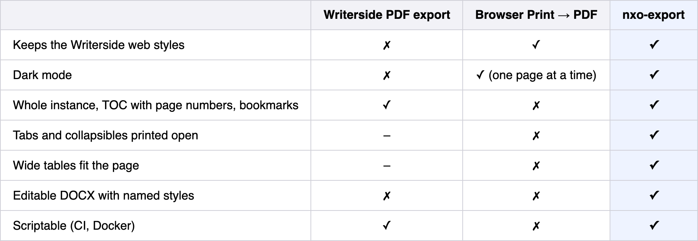
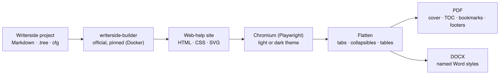
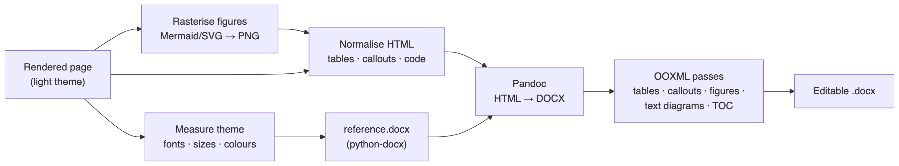
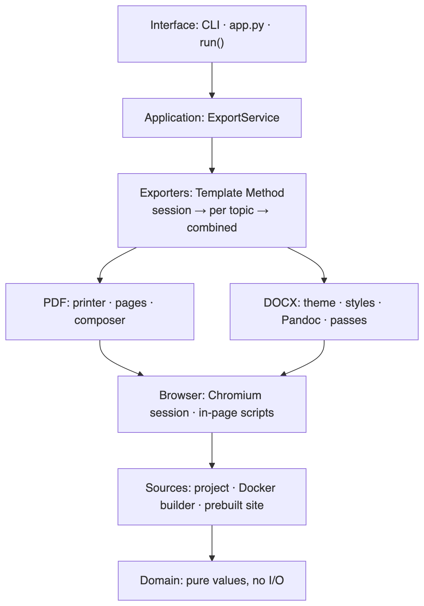

# From Web Help to Word: Exporting JetBrains Writerside Documentation to Print-Ready PDF and Editable DOCX

*How nxo-export reuses the official Writerside renderer, a headless browser and Pandoc to produce documents that keep the published look, and why translating to native Word styles beats taking a screenshot.*

---

## Abstract

Docs-as-code tools such as JetBrains Writerside give engineering teams versioned, reviewable and reusable documentation. Their output, however, is built for the web. Organisations still need *documents*: PDFs for distribution and archiving, and Word files that non-technical stakeholders can review and edit. This article presents **nxo-export**, an open Python tool that exports a Writerside instance to (a) print-ready PDF in the light or dark theme and (b) an editable DOCX built from named Word styles. Its central design decision is to **never re-implement Writerside**. The official builder renders the site, Chromium prints it, and Pandoc plus a set of Office Open XML (OOXML) post-processing passes translate it into Word. We describe the architecture, the main engineering problems (wide tables on paper, interactive elements, theme fidelity in a CSS-less format, diagrams) and how the tool was verified. We close with its limitations.

---

## 1. Introduction

Treating documentation like source code means plain-text sources, version control, pull-request review and automated builds. The approach is widely adopted because it keeps documentation close to the systems it describes [1]. JetBrains Writerside [2] is a mature tool in this space. Authors write Markdown, extended with semantic XML elements such as procedures, tabs, collapsible sections, definition lists and Mermaid diagrams. They organise topics into *instances* (tables of contents), and publish web help with a consistent, accessible theme in light and dark modes.

The web is not the only place documentation is read, though. In practice we kept meeting three needs:

1. **Distribution and archiving.** Regulated or contractual settings often require a fixed, paginated artefact, which in practice means a PDF.
2. **Offline and printed reading.** A PDF with a table of contents, page numbers and bookmarks is still the format people expect for long technical material.
3. **Collaborative editing by non-engineers.** Business analysts, reviewers and auditors work in Microsoft Word. They need to comment on, extend and reuse the content, and for that it must be *editable*, not a picture.

Writerside's built-in PDF export covers the first need but drops the web theme. Printing from the browser keeps the theme but works one page at a time. It also clips wide tables and leaves interactive elements in their on-screen state. Neither produces an editable Word document. nxo-export was built to fill these gaps without forking or re-implementing the renderer.

---

## 2. Background and related approaches

**Writerside's own PDF export.** The IDE and builder can generate PDF output. It handles a whole instance and adds a table of contents. However, it uses its own print layout rather than the web theme, and it has no dark mode.

**Browser printing.** Chromium's print-to-PDF engine applies the CSS Paged Media model [3] to the exact HTML and CSS that readers see. Fidelity is excellent, but a manual print covers one topic, with no cover, cross-document table of contents or bookmarks. Tabs show only the selected panel, collapsed sections stay collapsed, and tables that scroll horizontally on screen are cut off at the page edge.

**Converting the Markdown sources directly.** The obvious shortcut for DOCX is to run a Markdown-to-Word converter such as Pandoc [4] over the `.md` files. It fails for a fundamental reason: **Writerside Markdown is not plain Markdown.** Includes, variables, conditional filters, snippets, XML topics and semantic elements only take their final form after the Writerside builder has processed them. A direct conversion silently loses or garbles that content, and the result no longer matches what readers see on the published site.



*Table 1. What each approach provides.*

These observations lead to the guiding principle of nxo-export:

> **Do not re-implement Writerside. Let the official builder render the site, and work only from its output.**

---

## 3. Architecture



*Figure 1. The pipeline. One shared stage (build, render, flatten) feeds two back ends: PDF and DOCX.*

The pipeline has three stages (Figure 1).

**3.1 Build.** The official `jetbrains/writerside-builder` Docker image [5] renders the selected instance into a static web-help site. Because Writerside resolves its own markup, every include, variable and filter appears exactly as it would on the published site. The builder image is **pinned to a specific version**, because later stages depend on the structure of the generated HTML. Builds are cached under a fingerprint of the sources, the image and the instance, so repeated exports are instant until something changes. The builder always works on a copy, so the author's project is never modified. When a team already produces web help in CI, for example with the official GitHub Action [6], the build step can be skipped and a prebuilt site or zip used instead.

**3.2 Render and flatten.** Each topic is opened in headless Chromium through Playwright [7] with the requested theme. Writerside's own light or dark styles are used rather than a re-styled copy. A small set of in-page scripts then turns the interactive page into a static one:

- every **tab** is shown in turn under its own title;
- every **collapsible** section is expanded;
- navigation, search and other on-screen chrome are hidden;
- every **table** is measured against the printable width (see §4.1).

**3.3 Export.** Two back ends consume the flattened pages. The **PDF exporter** prints them and composes the result into a single book. The **DOCX exporter** translates them into native Word structures. Both can produce one combined document, one file per topic, or both.

---

## 4. The PDF back end

Since the browser already renders Writerside perfectly, the PDF exporter does not attempt any layout of its own. Its job is to make a web page behave like paper.

**4.1 Wide tables.** On screen, Writerside wraps wide tables in a horizontally scrolling container. On paper that container simply clips: the columns past the margin are lost. nxo-export measures each table's natural width against the printable width. When a table is too wide, it scales the table down, but never below a configurable minimum (75% by default). Only past that point does it let text wrap. The table stays readable, and no content is lost.

**4.2 Theme fidelity, including dark mode.** The light and dark PDFs use the exact palette Writerside provides in the browser, because they *are* the browser rendering. A dark PDF is useful for on-screen reading and presentations, and it comes for free with this approach.

**4.3 Composition.** Topic PDFs printed by Chromium are merged with pypdf [8]. The combined document gets a generated cover, a table of contents with real page numbers, PDF bookmarks that mirror the Writerside tree, and "Page X of Y" footers stamped onto every page.

---

## 5. The DOCX back end: translation, not screenshots

The DOCX exporter is the novel part of the work, because Writerside has no equivalent. The core difficulty is that **Word has no CSS**. A faithful-looking document cannot be produced by embedding the rendered page as an image. That would look right and be useless to someone who has to edit it. Instead, the rendered page is *translated* into native Word structures, and the Writerside look is captured as **named Word styles**.



*Figure 2. The DOCX pipeline. The Writerside theme is measured in the browser, and the measurements become a Word style sheet (reference.docx) that Pandoc applies during conversion. OOXML passes then refine the result.*

**5.1 Measuring the theme.** While the page is open in Chromium, the exporter reads the *computed* styles of representative elements: body text, each heading level, code, tables and callouts. These include font families, sizes, colours and vertical spacing. From these measurements it generates a `reference.docx` with python-docx [9]. This is a Word template whose styles (`Heading 1`–`6`, `Body Text`, `Source Code`, `Table`, `Callout Note`, and so on) reproduce the Writerside look. All styles are declared in a single catalogue, so the mapping from web to Word is explicit and reviewable.

**5.2 Figures.** Mermaid [10] diagrams and other SVGs are rasterised in the browser into sharp PNGs at twice the screen density, **always from the light theme**. Word has no dark mode, and a document that will be printed or shared must be readable on white paper.

**5.3 Normalising and converting.** The rendered HTML is simplified into constructs Pandoc understands well: tables, callouts, code, links and figures. Pandoc [4] then converts it to DOCX, using the generated `reference.docx` as its style sheet.

**5.4 OOXML passes.** Pandoc's output is a sound starting point. Matching Writerside requires further control, applied as a sequence of small, independent passes over the Office Open XML document [11]:

- **Tables.** Grid borders, a shaded header row repeated on every page, column widths taken from the browser's measurements, and wide tables scaled to fit.
- **Callouts.** Note, tip and warning blocks become shaded boxes like those on the site.
- **Figures.** Images are sized so they never exceed the printable width, and alt text is preserved for accessibility.
- **Text diagrams.** Engineers often draw diagrams with box-drawing characters (`┌ ─ │ └`) inside code blocks. A code block *without a language* that contains such characters gets a dedicated `Text Diagram` style: monospaced, with exact spacing, kept on one page. A block with a language stays as code.
- **Document structure.** A cover page, a pre-filled clickable table of contents, chapter breaks and page-numbered footers.

The result is a document in which **every element carries a named style**. When an analyst changes `Heading 2` or `Table` in Word, every occurrence updates. The document stays consistent while it is being edited, which a screenshot-based export can never offer.

---

## 6. Software design

nxo-export is a layered Python package (Python 3.11 or later). Each layer depends only on the layers below it (Figure 3).



*Figure 3. Layered architecture. Dependencies point inwards only. A dedicated test fails the build if a module imports from a layer above it.*

A few design choices are worth stating explicitly:

- **Pure domain core.** Values such as the site, its table-of-contents tree, page boxes and units are plain immutable data with no I/O. They are trivial to test.
- **Template Method for exporters** [12]. A base `Exporter` fixes the algorithm (open a session, export each topic, compose the combined document) and the PDF and DOCX exporters fill in the steps. Adding a format means writing one subclass and registering it.
- **A pipeline of document passes.** Every OOXML refinement is a separate `DocumentPass`. Passes are small, ordered and individually testable.
- **Enforced boundaries.** The dependency rule [13] is not left to convention: an architecture test inspects the imports and fails the build on a violation.
- **Typed configuration.** Settings are validated with Pydantic [14]. Layers are applied in a fixed order: built-in defaults, a shared YAML file, an optional per-environment file, a local file, environment variables, and finally command-line options. Unknown keys are rejected, so a typo fails loudly instead of being silently ignored.

The tool is used from the command line (built with Click [15]), from Python through a single `run()` function, or entirely inside Docker [16]. The Docker image is based on Microsoft's Playwright image and contains Chromium and Pandoc.

```bash
# Combined light PDF and an editable DOCX, plus one file per topic
python app.py -p /path/to/Writerside -i docs -f pdf -f docx -m both
```

```python
from nxo_export import run

report = run("/path/to/Writerside", "docs",
             formats=["pdf", "docx"], mode="both", theme="dark")
print(report.outputs)
```

---

## 7. Verification

Document generators fail in subtle ways: a shifted column width or a lost image does not raise an exception. nxo-export is therefore verified at four levels:

1. **Unit tests** (pytest [17]) for pure logic: configuration layering, table-of-contents handling, unit conversions, style mapping and the command-line interface.
2. **An architecture test** that enforces the layer boundaries and checks that every subpackage is included in the distribution.
3. **End-to-end tests** that run the real builder, browser and Pandoc against a real Writerside project.
4. **Golden snapshots.** A normalised textual description of every output (page counts, extracted text, DOCX structure and styles) is compared with an approved baseline. Every refactoring in the project's history had to reproduce the baseline exactly; intentional changes regenerate it on purpose.

Static analysis uses Ruff [18]. As a practical benchmark, a production documentation set of about 80 topics, rich in tables and Mermaid diagrams, exports to a combined PDF of roughly 940 pages and a DOCX with nearly 480 native, editable tables.

Two findings from this process are worth recording:

- **Print pagination is not strictly deterministic.** Rarely, Chromium paginates a long topic differently between runs, which shifts the page numbering after it. Snapshot comparisons need to account for this, for example by rerunning before treating a diff as a regression.
- **Font metrics differ between build and view.** The Writerside builder sizes Mermaid node labels in a container whose fonts differ from the published site's. Labels that fit on one line can therefore be clipped by a few characters in the browser, on the live site as well as in any export. Authors can work around this by padding labels with non-breaking spaces (`#nbsp;`).

---

## 8. Limitations and future work

- **Coupling to the builder version.** The in-page scripts depend on the structure of the generated HTML. The builder image is pinned, and upgrading it requires rerunning the end-to-end tests.
- **Word is not a browser.** The DOCX reproduces the look through styles. It is faithful, not a pixel copy.
- **Cross-topic links** in the DOCX become clickable only when the published site URL is configured. Links within the document always work.
- **External assets.** The site loads CSS and fonts from JetBrains' CDN. They are cached locally, and a fully offline mode exists for hermetic builds.

Natural next steps are round-tripping reviewed Word content back to Markdown, exporting to further formats through the exporter registry, and correcting Mermaid label sizing at export time.

---

## 9. Conclusion

nxo-export shows that rich documentation does not have to be confined to the web, and that keeping it portable does not require a second renderer. Delegating rendering to the official Writerside builder and printing with a real browser keeps the PDF faithful by construction. Translating the rendered page into named Word styles, rather than images, gives business stakeholders a document they can genuinely work with. Engineers keep the benefits of docs-as-code, and everyone else gets the same content in the format they need, from one source of truth.

---

## Acknowledgements

nxo-export stands on the work of others. It relies on **JetBrains Writerside** and its official builder for all rendering, and on **Pandoc** by John MacFarlane and contributors for document conversion. Microsoft's **Playwright** drives **Chromium**, and **Mermaid** produces the diagrams. The Python ecosystem supplied **python-docx**, **pypdf**, **Pydantic**, **Click**, **PyYAML**, **pytest** and **Ruff**, and **Docker** provides reproducible environments. The project was designed and implemented with the assistance of **GitHub Copilot CLI**, used as an AI pair programmer.

---

## References

[1] A. Gentle, *Docs Like Code*. Lulu Press, 2017.

[2] JetBrains, "Writerside." https://www.jetbrains.com/writerside/

[3] W3C, "CSS Paged Media Module Level 3." https://www.w3.org/TR/css-page-3/

[4] J. MacFarlane et al., "Pandoc: a universal document converter." https://pandoc.org/

[5] JetBrains, "writerside-builder Docker image." https://hub.docker.com/r/jetbrains/writerside-builder

[6] JetBrains, "Writerside GitHub Action." https://github.com/JetBrains/writerside-github-action

[7] Microsoft, "Playwright for Python." https://playwright.dev/python/

[8] pypdf contributors, "pypdf." https://pypdf.readthedocs.io/

[9] S. Canny et al., "python-docx." https://python-docx.readthedocs.io/

[10] K. Sveidqvist et al., "Mermaid: diagramming and charting tool." https://mermaid.js.org/

[11] Ecma International, "ECMA-376: Office Open XML File Formats." https://ecma-international.org/publications-and-standards/standards/ecma-376/

[12] E. Gamma, R. Helm, R. Johnson and J. Vlissides, *Design Patterns: Elements of Reusable Object-Oriented Software*. Addison-Wesley, 1994.

[13] R. C. Martin, *Clean Architecture: A Craftsman's Guide to Software Structure and Design*. Prentice Hall, 2017.

[14] Pydantic contributors, "Pydantic." https://docs.pydantic.dev/

[15] Pallets, "Click." https://click.palletsprojects.com/

[16] Docker Inc., "Docker." https://www.docker.com/

[17] pytest contributors, "pytest." https://docs.pytest.org/

[18] Astral, "Ruff." https://docs.astral.sh/ruff/
